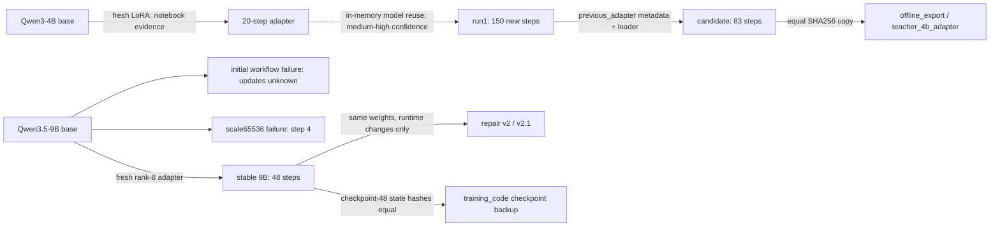

# Kiểm toán lịch sử huấn luyện ZAIC — 08/11/2026

Đã kiểm tra cục bộ D:\ZAIC; đọc metadata 54 thư mục Drive; kiểm tra tài khoản Kaggle lnghongphc bằng giao diện. Không chạy notebook, train, upload, hợp nhất adapter hoặc sửa artifact gốc.

## Kết luận theo bốn mục

1. **Sử dụng thành quả đã học:** tìm thấy 4 giai đoạn adapter thành công: bản 20 steps, run1 150 steps, candidate 4B 83 steps và stable 9B 48 steps. Hash trọng số/tệp checkpoint được tính lại trong lần kiểm toán này. Adapter 9B cuối vẫn khớp hash chuẩn. Chưa thực thi suy luận để chứng nhận runtime.
2. **Tiếp tục huấn luyện:** 7 checkpoint chính (9B 40/45/48, run1 125/150, candidate 80/83) và bản sao 9B checkpoint-48 có đủ optimizer/scheduler/scaler/RNG/trainer state không rỗng. Đây là đủ bộ tệp để chuẩn bị resume; chưa nạp pickle hoặc chạy resume. Bản 20 steps chỉ có adapter, không đủ khôi phục chính xác optimizer/RNG của bước đó.
3. **Tái lập:** chưa chứng nhận tái lập hoàn toàn bất kỳ run nào. Stable 9B có hồ sơ đầy nhất; run 4B chưa pin revision trong metadata và không có environment lock riêng đáng tin theo từng run; notebook đã sửa qua nhiều lượt, execution_count đều null. Mã hiện tại không chứng minh mọi phiên bản mã lỗi trước đó còn đủ.
4. **Thiếu/chưa xác minh:** chưa tìm thấy trọng số riêng của workflow lỗi ban đầu và lượt nonfinite step 4. Không kết luận đã mất hay được model cuối kế thừa. Chưa có danh mục nguồn toàn bộ các run ngoài phạm vi; checksum Drive live chưa kiểm được; chưa thấy bản trọng số đã lưu trên Kaggle.

## Bảng tổng quan run

| Run | Bắt đầu từ đâu và độ chắc chắn | Artifact giữ được | Tiếp tục train | Tái lập |
|---|---|---|---|---|
| 4B_20steps_20261106_043640 | Base model -> fresh LoRA according to notebook initialization; cell 8 trainer.train(); cell 20 saves trainer.model to 20-step backup. Notebook execution_count is null throughout: historical ordering remains imperfect. (medium: notebook + saved adapter; not a full ordered execution trace) | adapter cuối; checkpoints không | no full resumable checkpoint found | chưa chứng nhận |
| 4B_run1_20261106_044117 | Notebook cell 22 creates Trainer(model=trainer.model, args=replace(trainer.args,...)) and calls trainer_full.train() without resume_from_checkpoint. In-memory weights continue from prior trainer; likely 20-step weights, but null execution counters prevent a perfect proof. This is not optimizer resume. (medium-high: explicit in-memory model reuse + 150-step artifacts; exact pre-run bytes unavailable) | adapter cuối; checkpoints 125, 150 | checkpoint state file set present; execution unverified | chưa chứng nhận |
| 4B_candidate_20261106_090435 | run_metadata.json explicitly previous_adapter=adapter_intent_v0_run1_20261106_044117/final. train_candidate.py loads PeftModel.from_pretrained(base, resume_checkpoint or baseline_adapter). Initial parent strongly evidenced; automatic checkpoint-resume use during this run not proven by a launch receipt. (high for run1 weight parent; actual resume checkpoint unknown) | adapter cuối; checkpoints 80, 83 | checkpoint state file set present; execution unverified | chưa chứng nhận |
| 9B_initial_workflow_attempt | TRAIN_9B_CONFIG old_adapter_reused=false + source loads base and creates LoRA. No TRAIN_PROGRESS marker in WORKFLOW.log; do not infer successful optimizer updates. (medium for initialization; unknown number of weight updates) | chưa tìm thấy adapter riêng; checkpoints không | chưa tìm thấy checkpoint riêng | chưa chứng nhận |
| 9B_scale65536_failed_20261106_144528 | Metadata old_adapter_reused=false; workflow_resume.log reports step 1..4 and nonfinite gradients. Filename resume is not evidence of optimizer checkpoint resume. (high that 4-step attempt ran; parent checkpoint not documented) | chưa tìm thấy adapter riêng; checkpoints không | no checkpoint found (Drive checkpoints listing empty) | chưa chứng nhận |
| 9B_stable_48 | training_complete.json, metadata.json and TRAIN_9B_CONFIG: old_adapter_reused=false. Base Qwen3.5-9B + fresh rank-8 LoRA; no inherited 4B adapter. Source can auto-resume checkpoints but actual launch receipt specifying resume is absent. (high for fresh 9B adapter / no 4B weight reuse; checkpoint resume within run unproven) | adapter cuối; checkpoints 40, 45, 48 | checkpoint state file set present; execution unverified | chưa chứng nhận |

## Quan hệ kế thừa có bằng chứng

Mũi tên đứt từ 20 steps đến run1 thể hiện bất định của nhật ký thực thi: source cell 22 dùng trainer.model đang ở RAM, nhưng notebook không còn execution_count để chứng minh hoàn hảo model nào đang trong biến lúc đó. Không có cạnh kế thừa trọng số từ 4B sang 9B. Bản teacher_4b_adapter là bản sao được so hash, không phải bằng chứng merge adapter.

Không gọi run1 là checkpoint-170: 150 là bước của Trainer mới; khả năng đã kế thừa 20 cập nhật trước đó là quan hệ trọng số, không phải resume optimizer/global_step.

## Hồ sơ chi tiết từng run

### 4B_20steps_20261106_043640

- Thời điểm và căn cứ: 20-step output in notebook cell 8; backup folder timestamp 20261106_043640 has no timezone; Drive folder creation UTC available separately
- Base: Qwen/Qwen3-4B-Instruct-2507; revision: Run metadata/adapter config does not pin revision; local base_model_lock: cdbee75f17c01a7cc42f958dc650907174af0554 (not proof of historical load)
- Khởi tạo: Base model -> fresh LoRA according to notebook initialization; cell 8 trainer.train(); cell 20 saves trainer.model to 20-step backup. Notebook execution_count is null throughout: historical ordering remains imperfect.
- Trạng thái: 20-step output observed; adapter preserved
- Độ chắc chắn: medium: notebook + saved adapter; not a full ordered execution trace
- Môi trường: {"status": "notebook output lists transformers 5.22.0 / peft 0.21.2 / bnb 0.50.2; execution counters null and historical attribution uncertain; no run-specific complete pip lock found"}
- Bài học: Benchmark training (save_strategy=no); saved adapter backup exists but no optimizer/scaler/RNG checkpoint for the exact 20-step state.

| Artifact | Bytes | SHA256 | Step | Thiếu bộ resume |
|---|---:|---|---:|---|
| D:\ZAIC\PRIVATE_DATA\zaic\adapter_intent_v0_20steps_20261106_043640 | 132187888 | b853650e2d63fd8c5348553311505cfced77be87b0779e572de4ffde55b7b3ab | None | optimizer.pt, scheduler.pt, scaler.pt, rng_state.pth, trainer_state.json |

- Mã/cấu hình (hash chi tiết trong CSV/JSON): D:\ZAIC\ZAIC_QLoRA_intent_v0.ipynb
- Dữ liệu/manifest (chỉ hash/count, không nội dung): [{"path": "D:\\ZAIC\\PRIVATE_DATA\\zaic\\sft_data\\sft_train.jsonl", "bytes": 1127204, "sha256": "b8253725bedb05e66dc077a56ba811455f64bb768f9335d2b3d067c5a5a2badb", "rows": 2377}, {"path": "D:\\ZAIC\\PRIVATE_DATA\\zaic\\sft_data\\sft_val.jsonl", "bytes": 255617, "sha256": "03420083b369f50cdc02a5650db930dac7142a979ffb2c0d7e65a4a1a0b2ef4f", "rows": 538}]
- Log: không có log riêng; đối chiếu notebook và trainer_state
- Đánh giá tổng hợp: []
- Bản Drive: https://drive.google.com/file/d/18Krwb6V_Fc2gSS8goMDZw0b6jFpta8Mk/view?usp=drivesdk
- Kaggle: No saved weight artifact observed in lnghongphc account

### 4B_run1_20261106_044117

- Thời điểm và căn cứ: Folder stamp 20261106_044117 has no timezone; evaluation summary proves 150 training_steps_this_run; checkpoint states 125/150
- Base: Qwen/Qwen3-4B-Instruct-2507; revision: Run metadata/adapter config does not pin revision; local base_model_lock: cdbee75f17c01a7cc42f958dc650907174af0554 (not proof of historical load)
- Khởi tạo: Notebook cell 22 creates Trainer(model=trainer.model, args=replace(trainer.args,...)) and calls trainer_full.train() without resume_from_checkpoint. In-memory weights continue from prior trainer; likely 20-step weights, but null execution counters prevent a perfect proof. This is not optimizer resume.
- Trạng thái: completed: 150 steps this run
- Độ chắc chắn: medium-high: explicit in-memory model reuse + 150-step artifacts; exact pre-run bytes unavailable
- Môi trường: {"status": "notebook output lists transformers 5.22.0 / peft 0.21.2 / bnb 0.50.2; execution counters null and historical attribution uncertain; no run-specific complete pip lock found"}
- Bài học: 20 + 150 is a potential cumulative weight-update count, not trainer_state.global_step=170; the new Trainer resets its own step/optimizer. Exact cumulative lineage not independently snapshotted.

| Artifact | Bytes | SHA256 | Step | Thiếu bộ resume |
|---|---:|---|---:|---|
| D:\ZAIC\PRIVATE_DATA\zaic\adapter_intent_v0_run1_20261106_044117\final | 132187888 | 4f3873c6c32977c839fa7d860a5ac917fcb9b30a7f153bab109183a6210e8660 | None | optimizer.pt, scheduler.pt, scaler.pt, rng_state.pth, trainer_state.json |
| D:\ZAIC\PRIVATE_DATA\zaic\adapter_intent_v0_run1_20261106_044117\checkpoints\checkpoint-125 | 132187888 | ba3fe081b06c295537f01bb9508bab8e3d5a06d21ae91ef41fe4dbcd87e4cb5b | 125 | không thiếu tệp |
| D:\ZAIC\PRIVATE_DATA\zaic\adapter_intent_v0_run1_20261106_044117\checkpoints\checkpoint-150 | 132187888 | 4f3873c6c32977c839fa7d860a5ac917fcb9b30a7f153bab109183a6210e8660 | 150 | không thiếu tệp |

- Mã/cấu hình (hash chi tiết trong CSV/JSON): D:\ZAIC\ZAIC_QLoRA_intent_v0.ipynb
- Dữ liệu/manifest (chỉ hash/count, không nội dung): [{"path": "D:\\ZAIC\\PRIVATE_DATA\\zaic\\sft_data\\sft_train.jsonl", "bytes": 1127204, "sha256": "b8253725bedb05e66dc077a56ba811455f64bb768f9335d2b3d067c5a5a2badb", "rows": 2377}, {"path": "D:\\ZAIC\\PRIVATE_DATA\\zaic\\sft_data\\sft_val.jsonl", "bytes": 255617, "sha256": "03420083b369f50cdc02a5650db930dac7142a979ffb2c0d7e65a4a1a0b2ef4f", "rows": 538}]
- Log: không có log riêng; đối chiếu notebook và trainer_state
- Đánh giá tổng hợp: [{"path": "D:\\ZAIC\\PRIVATE_DATA\\zaic\\adapter_intent_v0_run1_20261106_044117\\evaluation\\summary.json", "sha256": "ef8ba8be9c4cf3e0cf599dc09923a6864d01710ac3ddfce959bef4ba12b2d90e", "aggregate": {"n": 538, "training_steps_this_run": 150, "epoch": 2.0, "counts": {"json_object": 538, "schema_ok": 538, "intent": 506, "answer_type": 535, "time": 530, "k": 537, "all_exact": 497}, "accuracy": {"json_object": 1.0, "schema_ok": 1.0, "intent": 0.9405204460966543, "answer_type": 0.9944237918215614, "time": 0.9851301115241635, "k": 0.9981412639405205, "all_exact": 0.9237918215613383}}}, {"path": "D:\\ZAIC\\PRIVATE_DATA\\zaic\\adapter_intent_v0_run1_20261106_044117\\checkpoints\\train_results.json", "sha256": "c84329b3bd4f3fed2f2ab8331e16d5db4d21a6c8fe2edbe7d05930dff39793bf", "aggregate": {"epoch": 2.0, "train_loss": 0.02288382259507974, "train_runtime": 1873.2841}}]
- Bản Drive: https://drive.google.com/file/d/1BTo_iRpEdIxWH4_qvqcn__DjdNUt07PS/view?usp=drivesdk; https://drive.google.com/file/d/1rwwpYEXDCoRULt3zsWDZerkWit1e4geJ/view?usp=drivesdk; https://drive.google.com/file/d/1yUxgAe38vICJQmHTOxiqj67FFH0dJQjc/view?usp=drivesdk
- Kaggle: No saved weight artifact observed in lnghongphc account

### 4B_candidate_20261106_090435

- Thời điểm và căn cứ: Folder stamp 20261106_090435 has no timezone; checkpoint states 80/83; Drive final modification provides a storage timestamp
- Base: Qwen/Qwen3-4B-Instruct-2507; revision: Run metadata/adapter config does not pin revision; local base_model_lock: cdbee75f17c01a7cc42f958dc650907174af0554 (not proof of historical load)
- Khởi tạo: run_metadata.json explicitly previous_adapter=adapter_intent_v0_run1_20261106_044117/final. train_candidate.py loads PeftModel.from_pretrained(base, resume_checkpoint or baseline_adapter). Initial parent strongly evidenced; automatic checkpoint-resume use during this run not proven by a launch receipt.
- Trạng thái: completed: 83 steps
- Độ chắc chắn: high for run1 weight parent; actual resume checkpoint unknown
- Môi trường: {"status": "notebook output lists transformers 5.22.0 / peft 0.21.2 / bnb 0.50.2; execution counters null and historical attribution uncertain; no run-specific complete pip lock found"}
- Bài học: Existing 4B adapter is fine-tuned on a new 2642-row supervision dataset; candidate is not a fresh 9B model. Selection/evaluation must be read separately from train loss.

| Artifact | Bytes | SHA256 | Step | Thiếu bộ resume |
|---|---:|---|---:|---|
| D:\ZAIC\PRIVATE_DATA\zaic\datamate_v1\candidate_20261106_090435\final | 132187888 | 85fc3507d9026dbdb410d3f29e73891d5e0a33c6ca8b67652ddda26aecd116b0 | None | optimizer.pt, scheduler.pt, scaler.pt, rng_state.pth, trainer_state.json |
| D:\ZAIC\PRIVATE_DATA\zaic\datamate_v1\candidate_20261106_090435\checkpoints\checkpoint-80 | 132187888 | 4b77db45ea08a49e6fdfc8bed0f831e701c95bca5008a50348338731b38efdec | 80 | không thiếu tệp |
| D:\ZAIC\PRIVATE_DATA\zaic\datamate_v1\candidate_20261106_090435\checkpoints\checkpoint-83 | 132187888 | 85fc3507d9026dbdb410d3f29e73891d5e0a33c6ca8b67652ddda26aecd116b0 | 83 | không thiếu tệp |

- Mã/cấu hình (hash chi tiết trong CSV/JSON): D:\ZAIC\PRIVATE_DATA\zaic\datamate_v1\train_candidate.py; D:\ZAIC\PRIVATE_DATA\zaic\datamate_v1\candidate_20261106_090435\run_metadata.json
- Dữ liệu/manifest (chỉ hash/count, không nội dung): [{"path": "D:\\ZAIC\\PRIVATE_DATA\\zaic\\datamate_v1\\training_v1\\sft_train_v1.jsonl", "bytes": 1303981, "sha256": "bb5f158b2282c13dd1184d554136a31fb7b4f63ad0dca15a95bb4d24637b2a6d", "rows": 2642}, {"path": "D:\\ZAIC\\PRIVATE_DATA\\zaic\\datamate_v1\\training_v1\\manifest.json", "bytes": 3844, "sha256": "7ef7a41f52613f17cfde3a948d2c5849a8ebe7c1aea007096e830f92de4399d7"}]
- Log: không có log riêng; đối chiếu notebook và trainer_state
- Đánh giá tổng hợp: [{"path": "D:\\ZAIC\\PRIVATE_DATA\\zaic\\datamate_v1\\candidate_20261106_090435\\checkpoints\\train_results.json", "sha256": "6b68b6d60d85014eda76d1da437db3cd74eebc3df6726130c639472cacbff1cb", "aggregate": {"epoch": 1.0, "train_loss": 0.021189645426460058, "train_runtime": 1105.002}}, {"path": "D:\\ZAIC\\PRIVATE_DATA\\zaic\\datamate_v1\\model_selection.json", "sha256": "f941afed6106317ac37d9e924f6393807549ded74787f3b51777a7883ee6f178", "aggregate": {}}]
- Bản Drive: https://drive.google.com/file/d/131drdRNFEl8r5Nb8BfQida852NG6kP-X/view?usp=drivesdk; https://drive.google.com/file/d/1ClzH9LlM0BOI-AFhPobVehQMag-nPXjO/view?usp=drivesdk; https://drive.google.com/file/d/1Naj36C6wqONJK8PDsuBoQl0SoWyYF_B9/view?usp=drivesdk
- Kaggle: No saved weight artifact observed in lnghongphc account

### 9B_initial_workflow_attempt

- Thời điểm và căn cứ: WORKFLOW.log Drive created 2026-11-06T14:17:36.414Z; exact launch time not recorded
- Base: Qwen/Qwen3.5-9B; revision: c202236235762e1c871ad0ccb60c8ee5ba337b9a
- Khởi tạo: TRAIN_9B_CONFIG old_adapter_reused=false + source loads base and creates LoRA. No TRAIN_PROGRESS marker in WORKFLOW.log; do not infer successful optimizer updates.
- Trạng thái: failed workflow, no separately identifiable weight artifact
- Độ chắc chắn: medium for initialization; unknown number of weight updates
- Môi trường: {"status": "later versions.json snapshot exists; exact failed-attempt library environment unproven"}
- Bài học: RuntimeError in initial workflow. Later candidate/final is from stable run and must not be assigned to this failed attempt merely because the working path was reused.

| Artifact | Bytes | SHA256 | Step | Thiếu bộ resume |
|---|---:|---|---:|---|

- Mã/cấu hình (hash chi tiết trong CSV/JSON): D:\ZAIC\PRIVATE_DATA\zaic\datamate_v1\qwen35_9b\app\train.py
- Dữ liệu/manifest (chỉ hash/count, không nội dung): [{"path": "D:\\ZAIC\\PRIVATE_DATA\\zaic\\datamate_v1\\qwen35_9b\\data\\sft_train.jsonl", "bytes": 1812620, "sha256": "5057658ac10c19579c675c9f926cc13f1e17641b88eb312318e48be75e6bb170", "rows": 768}, {"path": "D:\\ZAIC\\PRIVATE_DATA\\zaic\\datamate_v1\\qwen35_9b\\data\\manifest.json", "bytes": 3865, "sha256": "27eb28bf933fa37f7cb6802d4c9af5779a86cc5227a6ed691c7da8eb21452603"}]
- Log: D:\ZAIC\PRIVATE_DATA\zaic\datamate_v1\qwen35_9b\WORKFLOW.log
- Đánh giá tổng hợp: []
- Bản Drive: chưa đối chứng trọng số riêng
- Kaggle: No saved weight artifact observed in lnghongphc account

### 9B_scale65536_failed_20261106_144528

- Thời điểm và căn cứ: Archive suffix 20261106_144528 reflects archive/rename time; workflow_resume.log Drive created 2026-11-06T14:36:11.029Z
- Base: Qwen/Qwen3.5-9B; revision: c202236235762e1c871ad0ccb60c8ee5ba337b9a
- Khởi tạo: Metadata old_adapter_reused=false; workflow_resume.log reports step 1..4 and nonfinite gradients. Filename resume is not evidence of optimizer checkpoint resume.
- Trạng thái: failed: step 4 of 48; nonfinite gradients
- Độ chắc chắn: high that 4-step attempt ran; parent checkpoint not documented
- Môi trường: {"status": "later versions.json snapshot exists; exact failed-attempt library environment unproven"}
- Bài học: Initial FP16 loss scale 65536 produced NaN grad_norm; archived metadata/logs remain. No adapter/checkpoint found locally or in listed Drive failure folder. Save interval 5 and stopping at 4 may explain no scheduled checkpoint; this is not proof of lost data.

| Artifact | Bytes | SHA256 | Step | Thiếu bộ resume |
|---|---:|---|---:|---|
| D:\ZAIC\PRIVATE_DATA\zaic\datamate_v1\qwen35_9b\candidate_scale65536_failed_20261106_144528 | — | chưa tìm thấy | — | không thiếu tệp |

- Mã/cấu hình (hash chi tiết trong CSV/JSON): D:\ZAIC\PRIVATE_DATA\zaic\datamate_v1\qwen35_9b\candidate_scale65536_failed_20261106_144528\metadata.json
- Dữ liệu/manifest (chỉ hash/count, không nội dung): [{"path": "D:\\ZAIC\\PRIVATE_DATA\\zaic\\datamate_v1\\qwen35_9b\\data\\sft_train.jsonl", "bytes": 1812620, "sha256": "5057658ac10c19579c675c9f926cc13f1e17641b88eb312318e48be75e6bb170", "rows": 768}, {"path": "D:\\ZAIC\\PRIVATE_DATA\\zaic\\datamate_v1\\qwen35_9b\\data\\manifest.json", "bytes": 3865, "sha256": "27eb28bf933fa37f7cb6802d4c9af5779a86cc5227a6ed691c7da8eb21452603"}]
- Log: D:\ZAIC\PRIVATE_DATA\zaic\datamate_v1\qwen35_9b\workflow_resume.log; D:\ZAIC\PRIVATE_DATA\zaic\datamate_v1\qwen35_9b\progress_scale65536_failed_20261106_144528.json
- Đánh giá tổng hợp: []
- Bản Drive: chưa đối chứng trọng số riêng
- Kaggle: No saved weight artifact observed in lnghongphc account

### 9B_stable_48

- Thời điểm và căn cứ: Drive candidate folder created 2026-11-06T14:47:06.137Z; final adapter modified 2026-11-06T15:48:16.086Z; exact training start not asserted
- Base: Qwen/Qwen3.5-9B; revision: c202236235762e1c871ad0ccb60c8ee5ba337b9a
- Khởi tạo: training_complete.json, metadata.json and TRAIN_9B_CONFIG: old_adapter_reused=false. Base Qwen3.5-9B + fresh rank-8 LoRA; no inherited 4B adapter. Source can auto-resume checkpoints but actual launch receipt specifying resume is absent.
- Trạng thái: completed: 48 steps
- Độ chắc chắn: high for fresh 9B adapter / no 4B weight reuse; checkpoint resume within run unproven
- Môi trường: {"torch": "2.11.0+cu130", "transformers": "5.22.0", "peft": "0.21.2", "accelerate": "1.15.0", "bitsandbytes": "0.50.2", "pandas": "2.2.3", "numpy": "2.4.6", "safetensors": "0.8.0", "huggingface-hub": "1.33.0"}
- Bài học: Stable configuration records initial_loss_scale=16 and finite gradients; completed 48 steps. Runtime v2/v2.1 later changed ingestion/contracts/execution, not these adapter weights.

| Artifact | Bytes | SHA256 | Step | Thiếu bộ resume |
|---|---:|---|---:|---|
| D:\ZAIC\PRIVATE_DATA\zaic\datamate_v1\qwen35_9b\candidate\final | 86623432 | e7dfa635beccce128c99f9d3fd993d33dbb4c88e73e3ddeccbc2bc915eec4a4d | None | optimizer.pt, scheduler.pt, scaler.pt, rng_state.pth, trainer_state.json |
| D:\ZAIC\PRIVATE_DATA\zaic\datamate_v1\qwen35_9b\candidate\checkpoints\checkpoint-40 | 86623432 | a3cc58132171506a53ebaea6f9736b40d4c71834635b0ca535eecaade61897b5 | 40 | không thiếu tệp |
| D:\ZAIC\PRIVATE_DATA\zaic\datamate_v1\qwen35_9b\candidate\checkpoints\checkpoint-45 | 86623432 | 8334c2bdaddc87dcfc28ed25c0427d0f1e3edbe3b9abdeedce0ce599d0e74aa0 | 45 | không thiếu tệp |
| D:\ZAIC\PRIVATE_DATA\zaic\datamate_v1\qwen35_9b\candidate\checkpoints\checkpoint-48 | 86623432 | e7dfa635beccce128c99f9d3fd993d33dbb4c88e73e3ddeccbc2bc915eec4a4d | 48 | không thiếu tệp |

- Mã/cấu hình (hash chi tiết trong CSV/JSON): D:\ZAIC\PRIVATE_DATA\zaic\datamate_v1\qwen35_9b\app\train.py; D:\ZAIC\PRIVATE_DATA\zaic\datamate_v1\qwen35_9b\app\modeling.py; D:\ZAIC\PRIVATE_DATA\zaic\datamate_v1\qwen35_9b\app\build_data.py; D:\ZAIC\PRIVATE_DATA\zaic\datamate_v1\qwen35_9b\candidate\metadata.json; D:\ZAIC\PRIVATE_DATA\zaic\datamate_v1\qwen35_9b\model_lock.json
- Dữ liệu/manifest (chỉ hash/count, không nội dung): [{"path": "D:\\ZAIC\\PRIVATE_DATA\\zaic\\datamate_v1\\qwen35_9b\\data\\sft_train.jsonl", "bytes": 1812620, "sha256": "5057658ac10c19579c675c9f926cc13f1e17641b88eb312318e48be75e6bb170", "rows": 768}, {"path": "D:\\ZAIC\\PRIVATE_DATA\\zaic\\datamate_v1\\qwen35_9b\\data\\manifest.json", "bytes": 3865, "sha256": "27eb28bf933fa37f7cb6802d4c9af5779a86cc5227a6ed691c7da8eb21452603"}, {"path": "D:\\ZAIC\\PRIVATE_DATA\\zaic\\datamate_v1\\qwen35_9b\\data\\split.json", "bytes": 509, "sha256": "4f12303bf02a82ee10d86994c3d6c8ea293517523dcfc8ef9065f10e07707bd5"}]
- Log: D:\ZAIC\PRIVATE_DATA\zaic\datamate_v1\qwen35_9b\TRAIN_9B.log; D:\ZAIC\PRIVATE_DATA\zaic\datamate_v1\qwen35_9b\workflow_stable.log; D:\ZAIC\PRIVATE_DATA\zaic\datamate_v1\qwen35_9b\training_complete.json
- Đánh giá tổng hợp: [{"path": "D:\\ZAIC\\PRIVATE_DATA\\zaic\\datamate_v1\\qwen35_9b\\candidate\\checkpoints\\train_results.json", "sha256": "8b1765568978f9ebd252f526a7e56136e18d6face8e6f5129acfec838754e38b", "aggregate": {"epoch": 1.0, "train_loss": 0.06034040313534206, "train_runtime": 3668.9889}}, {"path": "D:\\ZAIC\\PRIVATE_DATA\\zaic\\datamate_v1\\qwen35_9b\\calibration_candidate\\evaluation.json", "sha256": "5f3a2aae0d63d935a107cc6bb00d57a46ee1e367571358a05273567d5849c1ed", "aggregate": {"n": 24, "correct": 10, "wrong": 4, "abstain": 10, "PA": 0.25, "answered_accuracy": 0.7142857142857143}}, {"path": "D:\\ZAIC\\PRIVATE_DATA\\zaic\\datamate_v1\\qwen35_9b\\audit_selected\\evaluation.json", "sha256": "c5f7960fa1236a22da555c16abed080157447baa25aa7bda71f07456cf93675b", "aggregate": {"n": 48, "correct": 14, "wrong": 3, "abstain": 31, "PA": 0.22916666666666666, "answered_accuracy": 0.8235294117647058}}]
- Bản Drive: https://drive.google.com/file/d/15dHEsB5gctrzq-RvkIj-lG05klopAzuY/view?usp=drivesdk; https://drive.google.com/file/d/1GlRIJbp64wnxpU9mueYpRy2Szls2cN6X/view?usp=drivesdk; https://drive.google.com/file/d/1Zr8NQClRUa3790w0WqNSBD1vYj8NvldA/view?usp=drivesdk; https://drive.google.com/file/d/1x3RFdN3QnQ1QpZrK26WQZlmXeAYAVjUi/view?usp=drivesdk
- Kaggle: No saved weight artifact observed in lnghongphc account

## Bản sao và checkpoint đầy đủ

| Bản sao | Run nguồn | Adapter hash giống | Trạng thái checkpoint so hash |
|---|---|---|---|
| D:\ZAIC\PRIVATE_DATA\zaic\datamate_v1\qwen35_9b\training_code\checkpoints\checkpoint-48 | 9B_stable_48 | True | {'optimizer.pt': True, 'scheduler.pt': True, 'scaler.pt': True, 'rng_state.pth': True, 'trainer_state.json': True} |
| D:\ZAIC\PRIVATE_DATA\zaic\datamate_v1\qwen35_9b\training_code\teacher_4b_adapter\final | 4B_candidate_20261106_090435 | True | {} |
| D:\ZAIC\PRIVATE_DATA\zaic\datamate_v1\offline_export\assets\adapter | 4B_candidate_20261106_090435 | True | {} |

Mọi bản trùng được giữ nguyên. Hash giống chỉ chứng minh artifact giống bytes tại thời điểm kiểm tra; không chứng minh có một lượt train mới hay một bản sao lưu độc lập trên ổ vật lý khác.

## Log lỗi và các sự kiện không phải huấn luyện

- **9B_smoke_initial_OOM**: OutOfMemoryError recorded; no saved adapter expected — Avoid blanket fp32 upcast of huge frozen embedding/head; see repaired smoke code/history.
- **9B_smoke_repaired_passed**: synthetic loss/backward smoke passed in historical runtime; adapter_saved=false — Model smoke success does not establish new model training or Kaggle compatibility.
- **runtime_v2_v21**: same 9B weights; code repair/evaluation, not a new training run — Calibration200 PA .35; confirmation2 PA .30. Opened confirmation2 cannot be called untouched holdout.
- **Kaggle_preparation**: 3 notebooks listed as drafts; no dataset/model listed; no saved training-weight artifact found — Historical notebook outputs do not prove a currently running or saved Kaggle training run.

Danh sách log/mã/ghi chú và hash để truy lại nằm trong TRAINING_AUDIT_EVIDENCE/TRAINING_HISTORY_DETAILS.json. Không loại các log lỗi. Các lần public inference, journal replay, repair v2/v2.1 và preflight được phân biệt với lượt cập nhật trọng số.

## Đối chiếu máy – Drive – Kaggle

- Đã so 68 tệp trọng số/config/state theo đường dẫn và kích thước Drive; 0 mục không khớp kích thước hoặc chưa có bản máy trong tập này. Danh sách từng file có URL trong JSON chi tiết.
- Connector không trả md5Checksum/sha256Checksum dù yêu cầu fields. Vì vậy các bản Drive này chỉ được đánh dấu đã thấy/khớp size, không đánh dấu đã đồng bộ checksum. Hash máy khớp manifest bàn giao là bằng chứng riêng, không phải kiểm mới hash live Drive.
- List nguồn resume_own và verified bằng connector trả rỗng; không suy ra Drive gốc đã trống hoặc dữ liệu mất. Bộ verified vẫn có bản cục bộ đã được kiểm ở lần trước.
- Kaggle Your Work/Code hiện có 3 mục draft. Notebook preflight được xem trực tiếp: 0 versions, session off, No input attached. Your Datasets và Your Models: No results found. Không thấy bản trọng số đã lưu trên tài khoản đang truy cập; không kết luận về tài khoản khác hoặc vùng draft disk chưa đọc.
- Tìm thư mục Drive bằng search ZAIC/adapter/candidate không có kết quả bổ sung; direct folder listing hoạt động. Search rỗng không phải chứng minh không còn các run ngoài danh sách.

## Cần bổ sung để đóng kiểm toán

1. Biên bản nguồn toàn bộ run/phiên Colab và mọi thư mục Drive ngoài zaic, Repair_v21, Resume_Own; xác định tài khoản sở hữu các thư mục connector chưa đọc được.
2. Hash Drive live cho adapter/checkpoint/state (hoặc tải một bản đối chiếu riêng có kiểm hash); chưa cần thay thế/xóa bất kỳ bản hiện có.
3. Mã/cấu hình đúng thời điểm chạy từng thất bại; transcript có thứ tự thực thi đáng tin hoặc launch receipt chỉ rõ checkpoint resume. Không dùng tên workflow_resume.log làm bằng chứng đã resume.
4. Base revision thực sự được nạp ở 4B và environment lock riêng từng run. Lock hiện có là ứng viên tái lập; không tự coi là lịch sử đã xác minh.
5. Kiểm thử inference/resume/reproduction riêng sau khi được giao; lần kiểm toán này chỉ kiểm artifact và metadata.
6. Giải thích bất nhất metadata total_size của base 4B (lệch 655.360 bytes) trước chứng nhận runtime; toàn bộ shard đã khớp manifest nguồn và không bị sửa.

RUN_REGISTRY.csv chứa từng run với mã/cấu hình, dataset hash, môi trường, metrics, bản sao và trạng thái checksum. Checkpoint state hash đầy đủ nằm trong TRAINING_AUDIT_EVIDENCE/CHECKSUM_MANIFEST.json. Không có raw question/answer/SFT trong các báo cáo này.

## Bổ sung: các phiên bản mã cũ nằm trong notebook

Đã giải mã an toàn 17 gói JSON nén trong các string literal của notebook (giới hạn dung lượng, chỉ parse bytes/AST, không exec). Tìm thấy source train_candidate.py ở cell 23 và 24 với hash khác nhau; train.py 9B ở cell 53 và 54 cũng có hash khác nhau. Đây là bằng chứng mã lịch sử vẫn còn trong notebook, chưa phải bằng chứng mọi phiên bản đều thực thi thành công. Chi tiết từng hash/cấu hình nằm trong TRAINING_AUDIT_EVIDENCE/EMBEDDED_CODE_SNAPSHOTS.json.

Do vậy không kết luận mã thử nghiệm thất bại đã mất. Phần chưa đầy đủ là liên kết chắc chắn phiên bản mã nào đã thực thi ở từng lần lỗi, vì execution_count đều null và chưa có receipt bất biến ghi source hash + resume checkpoint + environment cho từng lần chạy.

Kiểm tra chéo báo cáo: 6 mục run/attempt không trùng ID; 4 giai đoạn có adapter; 7 checkpoint chính đầy đủ bộ state; 1 bản sao checkpoint-48 khớp toàn bộ hash state; 14 adapter được tính hash lại, 137 tệp state/support/adapter được tính hash lại; 68 phép so size Drive đều khớp. SFT 9B hiện có đúng 768 dòng và đúng hash đã ghi trong training_complete. Không phép so size nào được nâng thành xác nhận checksum Drive.
